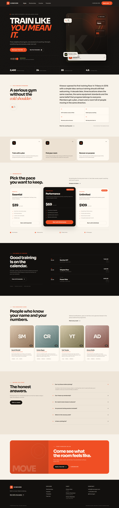
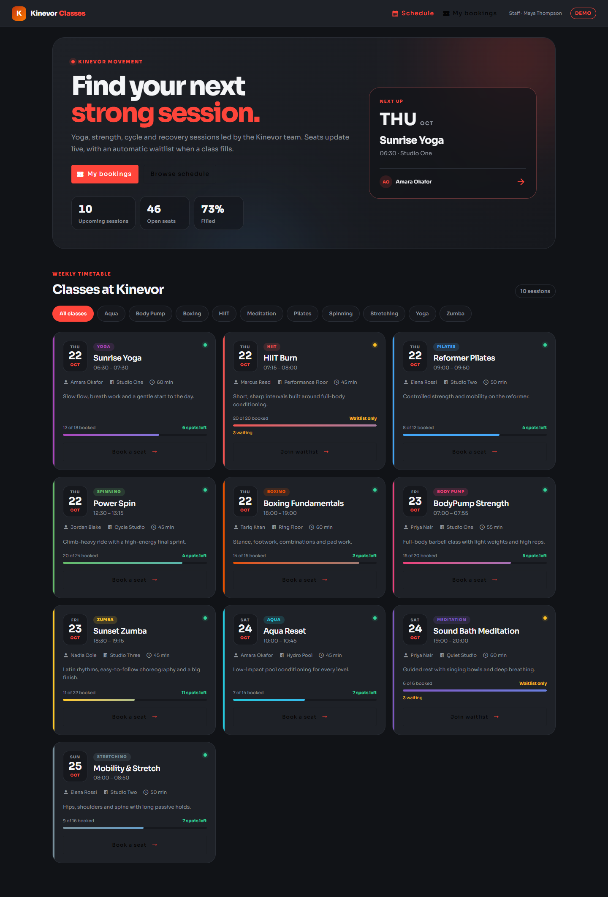
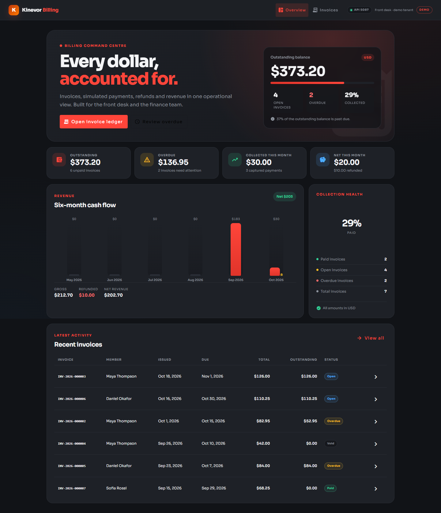
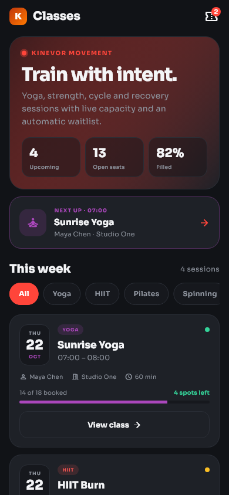
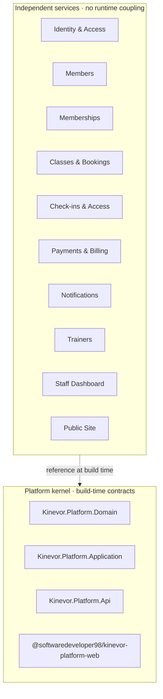

# Kinevor

<p align="center">
  
</p>

**A modular gym-operations platform in one repository.**

[](https://github.com/SoftwareDeveloper98/kinevor/actions/workflows/ci.yml)
[](https://github.com/SoftwareDeveloper98/kinevor/releases/latest)
[](https://dotnet.microsoft.com/)
[](https://angular.dev/)
[](https://flutter.dev/)
[](LICENSE)

Kinevor is a reference implementation of a gym-management product:
**ten independently buildable business modules** on a **shared .NET and Angular
platform kernel**. Each module owns its domain rules, HTTP API, SQLite database
and test suite; where the capability needs a UI it also ships a standalone
Angular library and/or a Flutter package.

The repository is built around service boundaries, layered backend design,
reusable frontend packages and automated verification. It is not a distributed
system.



> **Runtime boundary:** a monorepo is a source-control boundary, not a runtime
> one. The modules share versioned platform contracts, but they do **not** call
> each other, share databases or require each other at runtime. Every demo API
> starts on its own port with its own seeded SQLite file. See
> [ARCHITECTURE.md](ARCHITECTURE.md).

## At a glance

| | |
| --- | --- |
| Business modules | 10, plus a shared platform kernel |
| Backend | 10 ASP.NET Core 10 APIs, EF Core 10, SQLite, MediatR |
| Web | 9 Angular 22 libraries with runnable demos |
| Mobile | 9 Flutter packages with runnable examples |
| Automated tests | **435** — 208 .NET, 99 Angular, 128 Flutter |
| Screenshots | 57 captured from the running applications |
| CI | Platform build, backend/web/mobile matrices, CodeQL and Dependabot |

## Services

| Service | Responsibility | API | Web | Flutter | Demo API |
| --- | --- | :---: | :---: | :---: | ---: |
| [`kinevor-platform`](kinevor-platform/README.md) | Shared kernel: domain primitives, application contracts, API envelope, Angular services | — | ✔ | — | — |
| [`kinevor-identity-access`](kinevor-identity-access/README.md) | JWT authentication, refresh tokens and role-aware sessions | ✔ | ✔ | ✔ | 5082 |
| [`kinevor-members`](kinevor-members/README.md) | Member records, health context, progress, consents and privacy rights | ✔ | ✔ | ✔ | 5083 |
| [`kinevor-memberships`](kinevor-memberships/README.md) | Plans, subscriptions, renewal and benefit snapshots | ✔ | ✔ | ✔ | 5084 |
| [`kinevor-classes-bookings`](kinevor-classes-bookings/README.md) | Timetable, capacity, bookings and waitlists | ✔ | ✔ | ✔ | 5085 |
| [`kinevor-checkins-access`](kinevor-checkins-access/README.md) | Eligibility rules, check-in/out, occupancy and visit history | ✔ | ✔ | ✔ | 5086 |
| [`kinevor-payments-billing`](kinevor-payments-billing/README.md) | Invoices, simulated payments, refunds and revenue reporting | ✔ | ✔ | ✔ | 5087 |
| [`kinevor-notifications`](kinevor-notifications/README.md) | Inbox, delivery records, preferences, templates and suppressions | ✔ | — | ✔ | 5088 |
| [`kinevor-staff-dashboard`](kinevor-staff-dashboard/README.md) | Branch-scoped KPIs, trends, occupancy and operational alerts | ✔ | ✔ | ✔ | 5089 |
| [`kinevor-trainers`](kinevor-trainers/README.md) | Trainer directory, profiles and public-facing roster | ✔ | ✔ | ✔ | 5081 |
| [`kinevor-public-site`](kinevor-public-site/README.md) | Marketing site, plans, timetable and trial capture | ✔ | ✔ | — | 5090 |

`kinevor-notifications` is API-and-mobile only, `kinevor-public-site` is
web-and-API only, and the platform kernel has no runnable host. Each module
README documents its ports, routes, seeded data and demo credentials.

## Screenshots

| Public site | Staff dashboard |
| --- | --- |
|  |  |

| Members | Classes & bookings |
| --- | --- |
|  |  |

| Check-ins & access | Payments & billing |
| --- | --- |
|  |  |

| Members on mobile | Classes on mobile |
| --- | --- |
|  |  |

The full set of 57 screenshots — Swagger explorers, staff workflows, member
screens and mobile states — lives in each module's `docs/screenshots` folder.

## Architecture



The platform supplies the domain base types, repository and unit-of-work
contracts, `ApiResponse<T>` envelope, authorization policies and Angular
authentication, i18n, notice and theme services. Modules reference the platform
NuGet packages and the Angular package by version. They never reference each
other.

Each runtime service has:

- its own ASP.NET Core host, dependency-injection composition and port;
- its own SQLite database, created and seeded on first run;
- its own xUnit API and domain tests;
- its own Angular library and/or Flutter package for its clients.

[ARCHITECTURE.md](ARCHITECTURE.md) covers the layering conventions, package
workflow, module anatomy and the optional path to a gateway or shared deployment
if the system ever needs one.

## Technology

| Layer | Stack |
| --- | --- |
| Backend | ASP.NET Core 10 (`net10.0`), EF Core 10, SQLite, MediatR 12, JWT bearer, PBKDF2 password hashing, Swashbuckle, xUnit and `WebApplicationFactory` |
| Web | Angular 22 with standalone components, signals, typed gateways/facades, Angular Material and Vitest |
| Mobile | Flutter 3.35+ (verified with 3.47.8), Material 3, typed HTTP client and repository, widget and golden tests |
| Tooling | GitHub Actions matrices, NuGet, npm, Dart/Flutter, Mermaid diagrams |

The Angular platform package includes an English/Arabic localization service with
RTL support and locale-aware dates, numbers and currency. Individual demo
screens are English-first.

## Repository layout

```text
kinevor/
├── kinevor-platform/           shared kernel: .NET packages + Angular library
├── kinevor-identity-access/    backend/ · web/ · mobile/ · docs/
├── kinevor-members/            backend/ · web/ · mobile/ · docs/
├── kinevor-memberships/        backend/ · web/ · mobile/ · docs/
├── kinevor-classes-bookings/   backend/ · web/ · mobile/ · docs/
├── kinevor-checkins-access/    backend/ · web/ · mobile/ · docs/
├── kinevor-payments-billing/   backend/ · web/ · mobile/ · docs/
├── kinevor-notifications/      backend/ · mobile/ · docs/
├── kinevor-trainers/           backend/ · web/ · mobile/ · docs/
├── kinevor-staff-dashboard/    backend/ · web/ · mobile/ · docs/
├── kinevor-public-site/        backend/ · web/ · docs/
├── docs/branding/              Kinevor Gym logo
├── docs/screenshots/           portfolio showcase images
├── .github/workflows/ci.yml    platform jobs + three module matrices
├── ARCHITECTURE.md             design and conventions
├── SECURITY.md                 security policy and demo caveats
├── CONTRIBUTING.md             how to build, test and open a change
├── CODE_OF_CONDUCT.md          community standards
└── CHANGELOG.md                release history
```

## Quick start

### Prerequisites

- **.NET SDK 10** to build and run the `net10.0` projects; the SDK includes the
  ASP.NET Core runtime they need.
- **Node.js 22.22.3+** and npm 11+ (Node 24 LTS recommended)
- **Flutter 3.35+** for the mobile packages

### 1. Build the platform artifacts once

Modules restore the platform from the local feed and the local Angular build.

```bash
dotnet pack kinevor-platform/backend/Kinevor.Platform.slnx -c Release \
  -o kinevor-platform/backend/artifacts/packages

cd kinevor-platform/web
npm ci
npm run build
cd ../..
```

### 2. Run a service

The members service is a good starting point:

```bash
# API + Swagger on http://localhost:5083
dotnet run --project kinevor-members/backend/samples/Kinevor.Modules.Members.DemoApi
```

```bash
# Angular demo on http://localhost:4202
cd kinevor-members/web
npm run install:local
npm start
```

```bash
# Flutter example (Chrome)
cd kinevor-members/mobile/packages/kinevor_members
flutter pub get
cd example
flutter run -d chrome
```

`npm run install:local` temporarily binds the module workspace to the sibling
platform build, installs dependencies and restores `package.json`. Use the same
pattern for any other module; see its README for the exact port and routes.

The demo APIs use development-only role headers for screenshots and tests. They
are intentionally not production authentication — see [SECURITY.md](SECURITY.md).

## Testing

All suites were run on 2026-10-27:

| Suite | Tests | Result |
| --- | ---: | --- |
| .NET — platform + 10 module APIs | 208 | ✅ all passed |
| Angular — 9 module libraries | 99 | ✅ all passed |
| Flutter — 9 packages | 128 | ✅ all passed |
| **Total** | **435** | **✅ all passed** |

Run an individual suite:

```bash
# Backend (repeat per module)
dotnet test kinevor-platform/backend/Kinevor.Platform.slnx -c Release
dotnet test kinevor-members/backend/Kinevor.Modules.Members.slnx -c Release

# Web
cd kinevor-members/web
npm run install:local
npm test

# Mobile
cd kinevor-members/mobile/packages/kinevor_members
flutter test
```

The backend tests cover domain rules, handlers and HTTP endpoints; web tests
cover gateways, facades and components; Flutter tests cover API clients, screen
states and golden layouts.

## Continuous integration

The [CI workflow](.github/workflows/ci.yml) runs on every push and pull request:

1. **Platform** — restores, builds, tests and packs the .NET kernel; builds the
   Angular package; publishes both as workflow artifacts.
2. **Module backend matrix** — each API restores the platform from the packed
   NuGet artifact, then builds and tests independently.
3. **Module web matrix** — each Angular workspace consumes the built platform
   package, then runs its tests and library/demo builds.
4. **Module mobile matrix** — each Flutter package checks formatting, runs
   `flutter analyze`, then its widget and golden tests.

That is what the matrices show: every service is verified as a standalone unit.
A separate [CodeQL workflow](.github/workflows/codeql.yml) scans C# and
TypeScript, and Dependabot checks NuGet, npm, pub and Actions dependencies every
week.

## Design highlights

- **Explicit service boundaries** — one business capability per module, no
  cross-module project references.
- **Reusable contracts** — platform packages keep the response envelope,
  authorization policies and client services consistent.
- **Tests next to the code** — domain, handler, endpoint, component and golden
  tests live beside what they verify.
- **Working demos** — every module ships a seeded API, a web demo and/or a mobile
  example, plus Swagger and screenshots.
- **Realistic workflows** — masked member data, consent history, waitlists,
  access rules, refunds, occupancy and billing KPIs.

## Scope and limitations

This is a portfolio reference implementation, deliberately scoped:

- Services are independent and **not orchestrated**; there is no API gateway,
  message bus, Docker Compose stack or cross-service transaction.
- Payments are simulated; notifications do not call an external e-mail or push
  provider.
- SQLite is used for zero-setup demos, not for production scale.
- Demo authentication headers are development-only; the demo hosts refuse to
  start outside the Development environment.
- Package publishing to GitHub Packages is optional and documented in each
  module's `PUBLISHING.md`; it is not required to run the repository.

## Documentation

- [Architecture and conventions](ARCHITECTURE.md)
- [Security policy](SECURITY.md)
- [Contributing](CONTRIBUTING.md)
- [Code of conduct](CODE_OF_CONDUCT.md)
- [Changelog](CHANGELOG.md)
- Module READMEs: [platform](kinevor-platform/README.md) ·
  [identity](kinevor-identity-access/README.md) ·
  [members](kinevor-members/README.md) ·
  [memberships](kinevor-memberships/README.md) ·
  [classes](kinevor-classes-bookings/README.md) ·
  [check-ins](kinevor-checkins-access/README.md) ·
  [payments](kinevor-payments-billing/README.md) ·
  [notifications](kinevor-notifications/README.md) ·
  [trainers](kinevor-trainers/README.md) ·
  [dashboard](kinevor-staff-dashboard/README.md) ·
  [public site](kinevor-public-site/README.md)

## Author

**George Victor Kamal** — [github.com/georgevictorkamal](https://github.com/georgevictorkamal)

The public repository and package namespace are
[`SoftwareDeveloper98/kinevor`](https://github.com/SoftwareDeveloper98/kinevor)
(`@softwaredeveloper98/*` on npm). Copyright is held by the author; that GitHub
account is the publishing and CI home.

## License

MIT. See [LICENSE](LICENSE).
