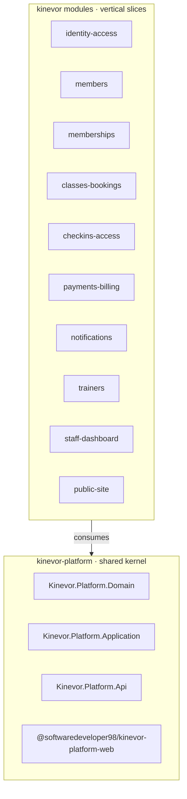

# Kinevor

[](https://github.com/SoftwareDeveloper98/kinevor/actions/workflows/ci.yml)
[](LICENSE)

A modular gym-management platform, delivered as one monorepo. **Kinevor** pairs
movement (*kinetic*) with vigor — the platform is built for momentum.

The repository is a **shared platform kernel** plus **ten vertical feature
modules**. Each module is a self-contained slice that ships the same three
consumers — a .NET API, a standalone Angular library with a runnable demo, and a
Flutter package — so every layer can be built, tested and reused independently,
while the monorepo keeps the whole product in one place.

## Architecture



Every module depends on the platform packages (NuGet `Kinevor.Platform.*` and the
`@softwaredeveloper98/kinevor-platform-web` Angular package) for the API envelope,
authorization policies, current-user abstractions, i18n, notices and theming. The
platform kernel has no product UI of its own.

## Module map

| Module | Purpose | Backend | Web | Flutter |
| --- | --- | :---: | :---: | :---: |
| [`kinevor-platform`](kinevor-platform/README.md) | Shared kernel: domain, application, API and Angular building blocks | ✔ | ✔ | — |
| [`kinevor-identity-access`](kinevor-identity-access/README.md) | JWT auth and role-aware session management | ✔ | ✔ | ✔ |
| [`kinevor-members`](kinevor-members/README.md) | Member management vertical slice | ✔ | ✔ | ✔ |
| [`kinevor-memberships`](kinevor-memberships/README.md) | Membership plans, recurring cover and subscription lifecycle | ✔ | ✔ | ✔ |
| [`kinevor-classes-bookings`](kinevor-classes-bookings/README.md) | Class scheduling, capacity, booking and waitlist | ✔ | ✔ | ✔ |
| [`kinevor-checkins-access`](kinevor-checkins-access/README.md) | Check-in, access eligibility, live occupancy and visit history | ✔ | ✔ | ✔ |
| [`kinevor-payments-billing`](kinevor-payments-billing/README.md) | Invoices, payments, refunds and revenue reporting | ✔ | ✔ | ✔ |
| [`kinevor-notifications`](kinevor-notifications/README.md) | Notification vertical slice (e-mail and push) | ✔ | — | ✔ |
| [`kinevor-trainers`](kinevor-trainers/README.md) | Trainer directory vertical slice | ✔ | ✔ | ✔ |
| [`kinevor-staff-dashboard`](kinevor-staff-dashboard/README.md) | Operating dashboard for the gym | ✔ | ✔ | ✔ |
| [`kinevor-public-site`](kinevor-public-site/README.md) | Public marketing site (Angular, SSR) | ✔ | ✔ | — |

Each module README contains its own architecture diagram, endpoints, screenshots,
quick-start and test commands.

## Tech stack

| Layer | Technology |
| --- | --- |
| Backend | ASP.NET Core 9, EF Core 9, MediatR, FluentValidation, JWT, PBKDF2/AES-256-GCM |
| Web | Angular 21 (standalone components, signals, `@if`/`@for`), Angular Material, SSR |
| Mobile | Flutter 3, BLoC + Clean Architecture, go_router, gen-l10n (en/ar + RTL) |
| Packages | NuGet (GitHub Packages), npm (GitHub Packages), Flutter (release archive) |
| CI | GitHub Actions (per-ecosystem build, test and pack jobs) |

## Repository layout

```text
kinevor/
├── kinevor-platform/          shared kernel (Domain / Application / Api / Web)
├── kinevor-identity-access/   backend/ · web/ · mobile/ · docs/
├── kinevor-members/           backend/ · web/ · mobile/ · docs/
├── kinevor-memberships/       backend/ · web/ · mobile/ · docs/
├── kinevor-classes-bookings/  backend/ · web/ · mobile/ · docs/
├── kinevor-checkins-access/   backend/ · web/ · mobile/ · docs/
├── kinevor-payments-billing/  backend/ · web/ · mobile/ · docs/
├── kinevor-notifications/     backend/ · mobile/ · docs/
├── kinevor-trainers/          backend/ · web/ · mobile/ · docs/
├── kinevor-staff-dashboard/   backend/ · web/ · mobile/ · docs/
├── kinevor-public-site/       backend/ · web/ · docs/
├── ARCHITECTURE.md            system overview and conventions
└── .github/workflows/ci.yml   monorepo CI
```

## Quick start

### Prerequisites

- .NET SDK 9 or 10 (solutions use `.slnx`)
- Node.js 22+ and npm 10+
- Flutter 3.35+ (verified with 3.47.7)

### 1. Build the platform packages

The modules restore `Kinevor.Platform.*` and
`@softwaredeveloper98/kinevor-platform-web` locally, so build the shared kernel
once from the repo root:

```powershell
# NuGet packages
dotnet pack kinevor-platform\backend\Kinevor.Platform.slnx -c Release `
  -o kinevor-platform\backend\artifacts\packages

# Angular package
cd kinevor-platform\web
npm ci
npm run build
cd ..\..
```

### 2. Run a module

Each module is self-contained. For example, identity & access:

```powershell
cd kinevor-identity-access
dotnet run --project backend\samples\Kinevor.Modules.IdentityAccess.DemoApi   # http://localhost:5082/swagger
```

```powershell
cd kinevor-identity-access\web
npm run install:local    # points the workspace at the local platform build
npm start                # http://localhost:4201
```

```powershell
cd kinevor-identity-access\mobile\packages\kinevor_identity_access
flutter pub get
cd example
flutter run -d chrome
```

See each module's README for its exact ports, routes, seeded accounts and
screenshot-refresh commands.

## Testing

| Area | Command |
| --- | --- |
| Platform backend | `dotnet test kinevor-platform\backend\Kinevor.Platform.slnx -c Release` |
| Platform web | `cd kinevor-platform\web; npm ci; npm run build` |
| Module backend | `dotnet test kinevor-<module>\backend\Kinevor.Modules.<Module>.slnx -c Release` |
| Module web | `cd kinevor-<module>\web; npm test` |
| Module Flutter | `cd kinevor-<module>\mobile\packages\kinevor_<module>; flutter test` |

The module backend and web jobs restore the platform packages from the local
feed you packed in step 1, or from GitHub Packages when published.

## Publishing

The platform kernel must be published before the modules (its version is `0.1.0`).
Each module contains a `PUBLISHING.md` with its release checklist and consumer
setup. See [`ARCHITECTURE.md`](ARCHITECTURE.md) for the shared conventions the
modules follow.

## Security

Never commit `.env` files, PATs or signing keys — the root `.gitignore` excludes
them. Demo credentials and demo signing keys are Development-only and are
documented per module. Report security issues privately to the repository owner.

## License

MIT. See [LICENSE](LICENSE).
