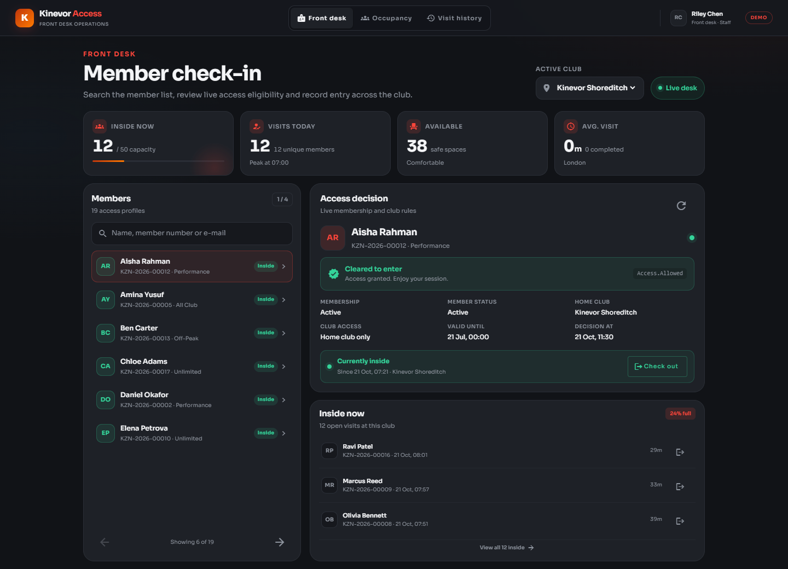
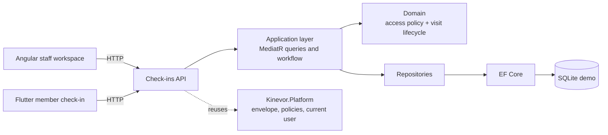
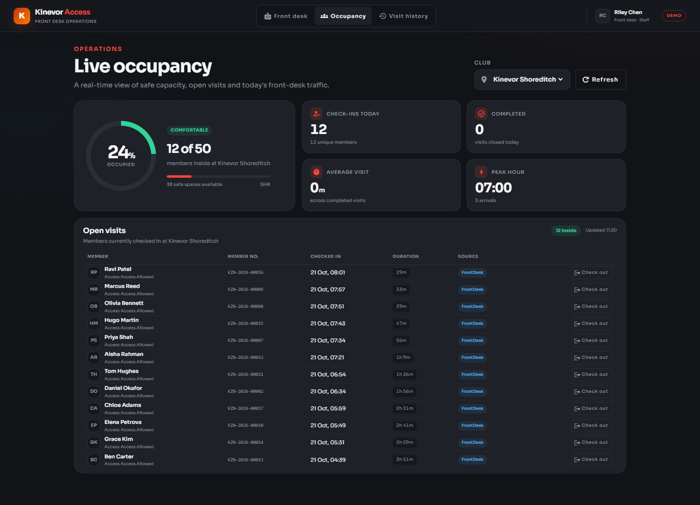
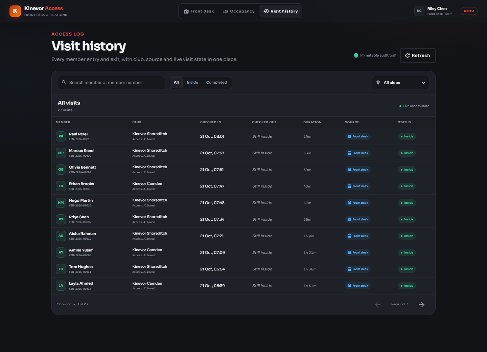
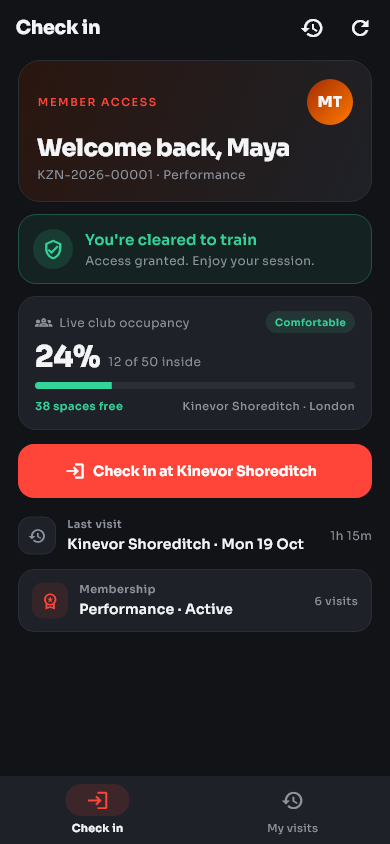
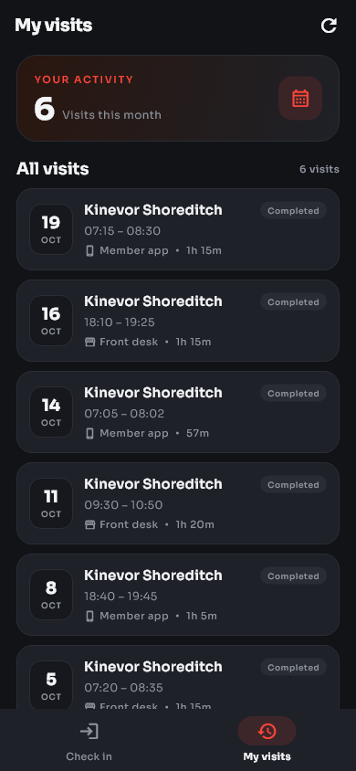
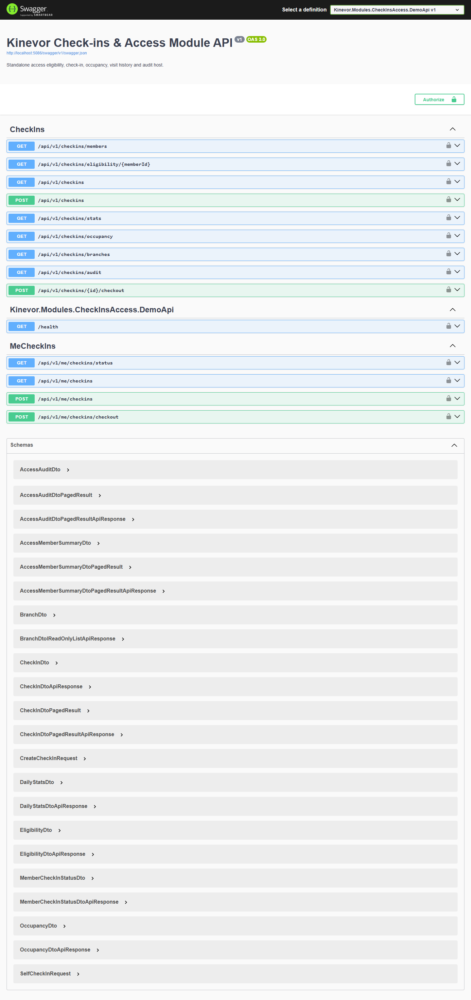

# Kinevor Check-ins & Access

Check-in, access eligibility, live occupancy and visit-history vertical slice
for the Kinevor gym platform: a .NET 9 API, a standalone Angular library and
demo, and a Flutter package with a runnable example. Every layer can be consumed
independently, and the demo runs locally from this monorepo.

[](https://github.com/SoftwareDeveloper98/kinevor/actions/workflows/ci.yml)
[](https://flutter.dev)
[](LICENSE)



## Why this module

Check-ins & Access is the gate between a membership and the gym floor. It keeps
the staff workflow fast while making the access decision explicit, explainable
and auditable.

- Staff search members, see live eligibility and record entry or exit.
- Access rules cover member and membership state, the membership date window,
  home-club restrictions and all-club memberships.
- Duplicate visits are rejected; denied attempts are retained in the audit log.
- Live occupancy and daily traffic show pressure across clubs.
- Members can see their access status, check themselves in and out, and review
  their visit history.
- Angular and Flutter clients consume the same API contract.

## Architecture



The backend is organized into domain/application/API folders within a single project, with a separate EF Core persistence project. It
depends on the published `Kinevor.Platform.*` packages for the response
envelope, authorization policies and current-user abstractions. Access members
are a local projection owned by this module; the wider member directory remains
outside the boundary.

The Angular library exposes standalone components, signal facades, a typed HTTP
gateway, providers and routes. The Flutter package is split into a typed client,
repository interface and presentation widgets so hosts can inject their own
transport and authentication.

## Features

### Front desk

- Paged member lookup by name, member number or e-mail.
- Branch switcher with eligibility evaluated against the selected club.
- Clear allow/deny decisions with stable reason codes and human-readable
  messages.
- Check-in and check-out actions with duplicate-visit protection.
- Live inside count, visits today, safe capacity and open-visit shortcuts.
- Visit history filters for member search, club, open/completed state and dates.
- Append-only access audit exposed to staff.

### Member self-service

- Access status, membership context and live occupancy for the home club.
- One-tap check-in at the home club and check-out of the current visit.
- Monthly visit count, last visit and paginated visit history.
- Clear handling of frozen, expired, suspended and branch-restricted access.

### Clients

- Angular: Material UI, Sora typography, responsive desktop workspace, typed
  gateway, signal facades, injectable providers and Vitest coverage.
- Flutter: Sora dark theme, Check in and My visits tabs, injectable repository,
  widget tests, golden tests and a runnable example.

## Endpoints

| Method | Route | Policy | Used by |
| --- | --- | --- | --- |
| `GET` | `/api/v1/checkins/members?search=&page=&pageSize=` | `StaffOrAdmin` | Front-desk member lookup |
| `GET` | `/api/v1/checkins/eligibility/{memberId}?branchId=` | `StaffOrAdmin` | Access decision |
| `GET` | `/api/v1/checkins?search=&memberId=&branchId=&from=&to=&status=&page=&pageSize=` | `StaffOrAdmin` | Visit history |
| `GET` | `/api/v1/checkins/stats?date=&branchId=` | `StaffOrAdmin` | Daily traffic |
| `GET` | `/api/v1/checkins/occupancy?branchId=` | `MemberOrAbove` | Live occupancy |
| `GET` | `/api/v1/checkins/branches` | `MemberOrAbove` | Club switcher |
| `GET` | `/api/v1/checkins/audit?memberId=&page=&pageSize=` | `StaffOrAdmin` | Access audit |
| `POST` | `/api/v1/checkins` | `StaffOrAdmin` | Front-desk check-in |
| `POST` | `/api/v1/checkins/{id}/checkout` | `StaffOrAdmin` | Front-desk check-out |
| `GET` | `/api/v1/me/checkins/status` | `MemberOrAbove` | Member access status |
| `GET` | `/api/v1/me/checkins?from=&to=&page=&pageSize=` | `MemberOrAbove` | Member visit history |
| `POST` | `/api/v1/me/checkins` | `MemberOrAbove` | Self check-in |
| `POST` | `/api/v1/me/checkins/checkout` | `MemberOrAbove` | Self check-out |
| `GET` | `/health` | anonymous | Demo health check |
| `GET` | `/swagger` | development only | API explorer |

All responses use the platform `ApiResponse<T>` envelope. A denied check-in
returns the policy message and records an audit entry before the request fails.

### Access rules

The pure `AccessPolicy` sequence is:

1. The member projection must be active.
2. The membership must be active and inside its start/end date window.
3. A branch-restricted member may only enter their home club.
4. An existing open visit blocks another check-in with a conflict response.

The decision is always re-evaluated on the server. Client-side eligibility is
informational only.

## Screenshots

### Web

| Member check-in | Live occupancy |
| --- | --- |
|  |  |

| Visit history |
| --- |
|  |

### Flutter

| Member check-in | Visit history |
| --- | --- |
|  |  |

### API



## Quick start

The commands below use PowerShell; on macOS or Linux use forward slashes.

### Prerequisites

- .NET SDK 10 (the solution uses `.slnx`) and the ASP.NET Core 9 runtime.
- Node.js 22.12+ and npm 11+.
- Flutter 3.35+ (the repository is verified with Flutter 3.47.7).

### 1. Build the platform packages

The backend restores `Kinevor.Platform.*` from the sibling platform folder's
local package feed. Pack it once:

```powershell
dotnet pack ..\kinevor-platform\backend\Kinevor.Platform.slnx -c Release `
  -o ..\kinevor-platform\backend\artifacts\packages
```

If the platform packages are published to a registry, configure that source
instead and skip the local pack step.

### 2. Run the API

```powershell
dotnet restore backend\Kinevor.Modules.CheckInsAccess.slnx
dotnet run --project backend\samples\Kinevor.Modules.CheckInsAccess.DemoApi
```

The API listens on `http://localhost:5086`. Open
`http://localhost:5086/swagger` for the explorer. The demo creates a SQLite
database and seeds two London clubs, 19 access profiles, open visits, Maya's
self-service history and access audits on first run.

| Demo fact | Value |
| --- | --- |
| Primary self-service member | Maya Thompson, `KZN-2026-00001` |
| Clubs | Kinevor Shoreditch (`SHR`, capacity 50), Kinevor Camden (`CAM`, capacity 35) |
| Open visits | 12 at Shoreditch, 3 at Camden |
| Maya's state | Active, no open visit, 8 completed visits |
| Audit records | 34 |

The demo trusts development-only headers:

| Header | Purpose | Example |
| --- | --- | --- |
| `X-Demo-Role` | Selects the authenticated role | `Staff`, `Member`, `Admin` |
| `X-Demo-User` | Sets the current user id | `staff-riley` |
| `X-Demo-Email` | Sets the current user e-mail | `riley.chen@kinevor.demo` |
| `X-Demo-Member` | Binds a member identity | `11111111-1111-1111-1111-111111111111` |
| `X-Branch-Id` | Selects the branch context | `aaaaaaaa-aaaa-aaaa-aaaa-aaaaaaaaaaaa` |

These headers are a demo adapter only. Never enable them in production.

### 3. Run the web demo

For local development, build the platform web package once:

```powershell
cd ..\kinevor-platform\web
npm install
npm run build
cd ..\..\kinevor-checkins-access\web
npm run install:local
npm start
```

`npm run install:local` temporarily points the workspace at the local platform
build, installs dependencies, restores `package.json`, and removes the generated
lockfile. If the platform package is published to a registry, authenticate the
scope in `.npmrc` and use the normal path instead:

```powershell
cd web
npm install
npm start
```

The web demo runs at `http://localhost:4205` with routes:

- `/checkins` - front-desk member lookup, eligibility and check-in/out
- `/checkins/occupancy` - live capacity, daily stats and open visits
- `/checkins/history` - searchable visit history with live status

The demo interceptor sends the `Staff` role and Riley Chen's identity. A real
host supplies its own authentication and platform configuration.

### 4. Run the Flutter example

```powershell
cd mobile\packages\kinevor_checkins_access
flutter pub get
cd example
flutter run -d chrome
```

The example targets `http://localhost:5086/api/v1` by default and uses Maya
Thompson's member headers. Override it for an emulator or remote host:

```powershell
flutter run -d chrome `
  --dart-define=CHECKINS_API_BASE_URL=http://localhost:5086/api/v1
```

On an Android emulator use `http://10.0.2.2:5086/api/v1`. The demo API allows the
Angular origin `http://localhost:4205`; add your host origin before running the
Flutter web example from another port.

### 5. Refresh screenshots

With both servers running:

```powershell
cd web
npm run capture:screenshots
```

The Playwright script writes `web-front-desk.png`, `web-occupancy.png`,
`web-history.png` and `api-swagger.png` to `docs/screenshots`. Regenerate the
Flutter goldens with:

```powershell
cd mobile\packages\kinevor_checkins_access
flutter test --update-goldens test\check_ins_golden_test.dart
```

Copy the goldens to `docs/screenshots/mobile-check-in.png` and
`docs/screenshots/mobile-history.png` after inspecting them.

## Testing

| Area | Command |
| --- | --- |
| Backend | `dotnet test backend\Kinevor.Modules.CheckInsAccess.slnx -c Release` |
| Web unit tests | `cd web; npm test` |
| Web builds | `cd web; npm run build:all` |
| Flutter analysis | `cd mobile\packages\kinevor_checkins_access; flutter analyze` |
| Flutter tests | `cd mobile\packages\kinevor_checkins_access; flutter test` |

The current suites contain 34 backend tests, 19 Vitest tests and 14 Flutter
tests. Backend coverage includes domain invariants, access decisions, occupancy,
history, audit, front-desk workflows, self-service and authorization against the
demo host. Web coverage includes the HTTP gateway and all three signal facades.
Flutter coverage includes the HTTP client, repository-driven screens and golden
images.

## Packages

| Ecosystem | Package | Contents |
| --- | --- | --- |
| NuGet | `Kinevor.Modules.CheckInsAccess` | Domain, application, API controllers and module registration |
| NuGet | `Kinevor.Modules.CheckInsAccess.EntityFrameworkCore` | `CheckInsDbContext`, mapping and repositories |
| npm | `@softwaredeveloper98/kinevor-checkins-access-web` | Angular components, gateway, facades, providers and routes |
| Flutter | `kinevor_checkins_access` | API client, repository, check-in/history screens, theme and strings |

If the Angular package is published to a registry, install it with:

```powershell
npm install @softwaredeveloper98/kinevor-checkins-access-web
```

Consume the Flutter package from the monorepo by path or git:

```yaml
dependencies:
  kinevor_checkins_access:
    git:
      url: https://github.com/SoftwareDeveloper98/kinevor.git
      path: mobile/packages/kinevor_checkins_access
      ref: main
```

Both clients use the same API contract. The Angular package expects
`@softwaredeveloper98/kinevor-platform-web` as a peer dependency.

The monorepo CI packs the platform once and feeds the artifacts to each module
job. Modules do not need a published registry to build.

## Design decisions

- **Server-authoritative access.** Eligibility is a pure domain policy evaluated
  again during check-in. The UI cannot grant access by hiding or changing state.
- **Explainable denials.** Every decision carries a stable code and a message,
  and denied attempts are audited.
- **One open visit per member.** The workflow rejects duplicate visits before
  creating a new visit.
- **Append-only audit.** Check-ins, check-outs and denied attempts are retained
  as an access trail.
- **Safe-capacity visibility.** Occupancy is derived from open visits and club
  capacity so staff can see pressure without changing the access decision.
- **Local access projection.** This module owns the minimal member snapshot it
  needs; the wider member directory remains a separate service boundary.
- **Thin clients.** Angular facades own presentation state; the Flutter package
  injects a repository so hosts can swap HTTP implementations.
- **Demo auth is explicit.** Trust headers exist only in Development and are sent
  by the demo interceptor/client.
- **Visual contract in tests.** Playwright and Flutter goldens make layout,
  typography and icon regressions visible.

## Repository layout

```text
kinevor-checkins-access/
  backend/
    src/Kinevor.Modules.CheckInsAccess/          domain, application, API
    src/Kinevor.Modules.CheckInsAccess.EntityFrameworkCore/
    samples/Kinevor.Modules.CheckInsAccess.DemoApi/
    tests/Kinevor.Modules.CheckInsAccess.Tests/
  web/
    projects/kinevor-checkins-access/            Angular library
    projects/demo/                               demo host
    scripts/                                     local install + screenshots
  mobile/
    packages/kinevor_checkins_access/            Flutter package
    packages/kinevor_checkins_access/example/    runnable demo
  docs/
    screenshots/
```

## Related modules

- [Kinevor Platform](../kinevor-platform) -
  shared API, auth, i18n, notices and Angular primitives.
- [Kinevor Identity & Access](../kinevor-identity-access)
- [Kinevor Members](../kinevor-members)
- [Kinevor Trainers](../kinevor-trainers)
- [Kinevor Memberships](../kinevor-memberships)
- [Kinevor Classes & Bookings](../kinevor-classes-bookings)
- [Kinevor Payments & Billing](../kinevor-payments-billing)
- [Kinevor Notifications](../kinevor-notifications)
- [Kinevor Public Site](../kinevor-public-site)
- [Kinevor Staff Dashboard](../kinevor-staff-dashboard)

## Verification

- Run this module's backend, web and mobile suites (commands above).
- The root CI runs the module in its backend, web and/or mobile matrix.
- See [PUBLISHING.md](PUBLISHING.md) only if you intend to distribute packages.

## Security

The demo role headers are intentionally insecure and exist only for local
screenshots and tests. Production hosts must use the platform authentication
stack, enforce the published policies, and keep the demo adapter disabled.
Access decisions and audit records contain member identifiers; protect them with
transport encryption, least-privilege access and log retention policies. Do not
commit connection strings, PATs or `.env` files.

## License

MIT. See [LICENSE](LICENSE).
