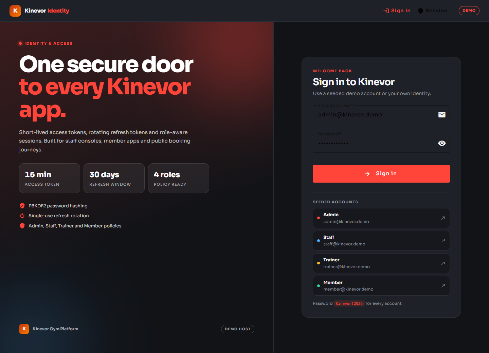
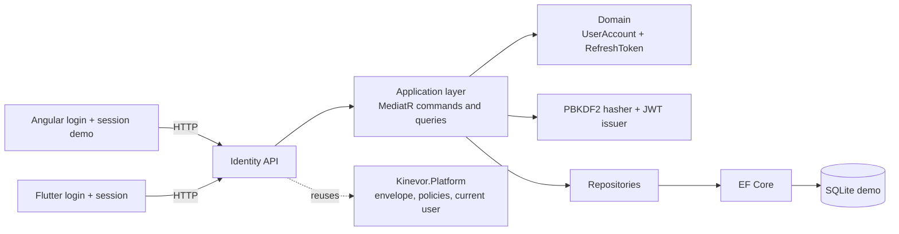
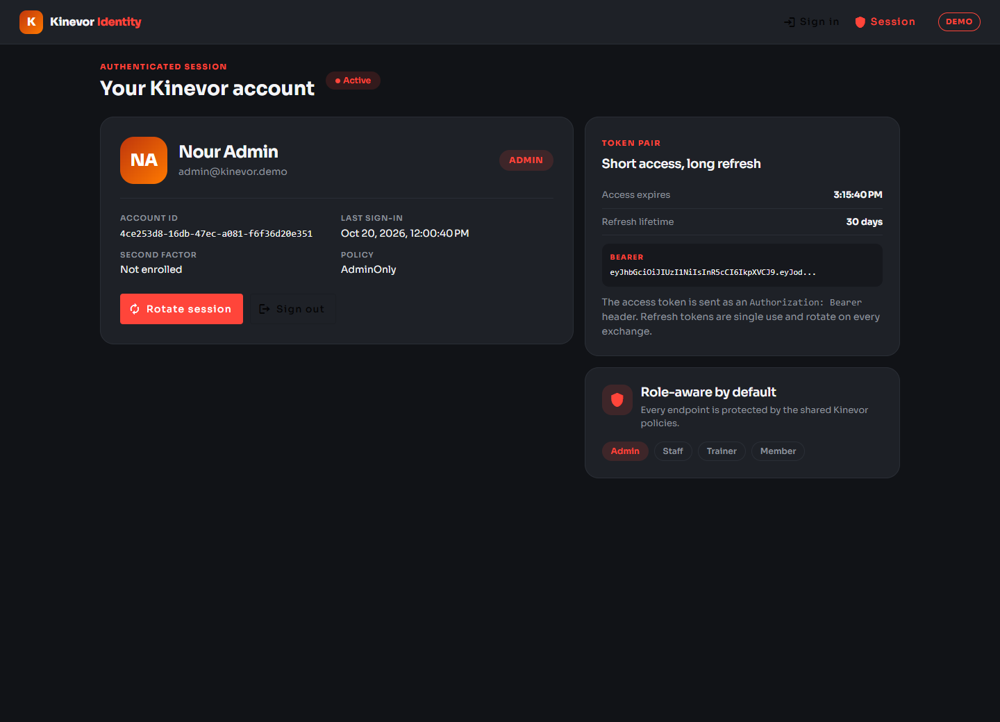
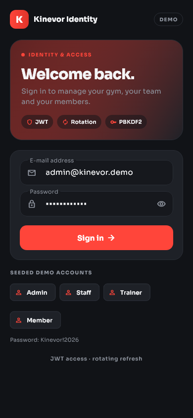
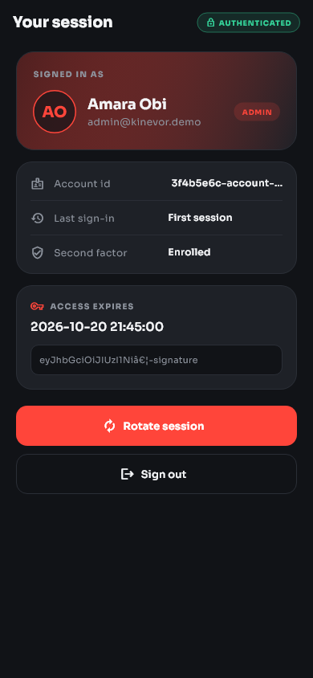
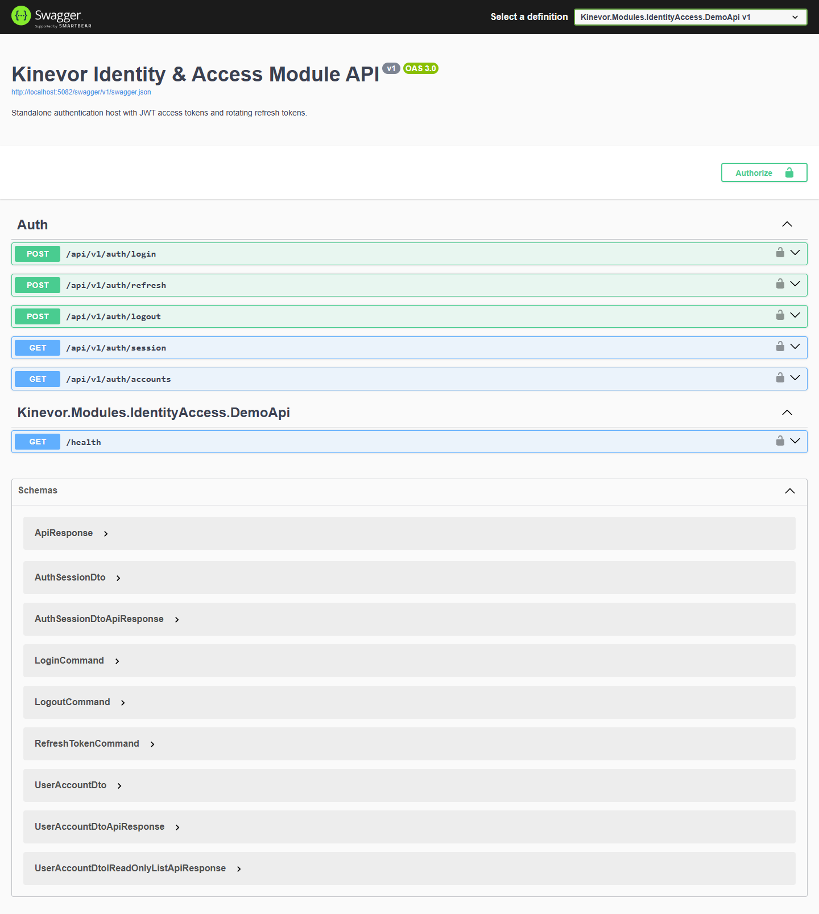

# Kinevor Identity & Access

JWT authentication and role-aware session management for the Kinevor gym
platform: a .NET 9 API, a standalone Angular library and demo, and a Flutter
package with a runnable example. Every layer can be consumed independently, and
the demo runs locally from this monorepo.

[](https://github.com/SoftwareDeveloper98/kinevor/actions/workflows/ci.yml)
[](https://flutter.dev)
[](LICENSE)



## Why this module

Identity is the front door to every Kinevor application. This module packages
that door as a vertical slice: domain rules, application handlers, a versioned
NuGet package, an HTTP API, an Angular package, a Flutter package, demos and a
CI/release pipeline.

- Members, trainers, staff and admins sign in through one hardened endpoint.
- Short-lived JWT access tokens keep the API stateless.
- Refresh tokens are hashed, single-use and rotated on every exchange.
- Angular and Flutter clients share the same login and session contract.
- Hosts decide where tokens are stored and how their own routes are guarded.

## Architecture



The backend is organized into domain/application/API folders within a single project. The API
depends on the published `Kinevor.Platform.*` packages for the response
envelope, authorization policies and current-user abstractions. The Angular and
Flutter clients are thin presentation layers over a typed gateway/repository.

## Features

- E-mail/password login with PBKDF2-HMAC-SHA256 (120,000 iterations).
- HS256 JWT access tokens with configurable issuer, audience and lifetime.
- Opaque refresh tokens stored as SHA-256 hashes, rotated on every exchange and
  revoked on logout.
- Role claims for `Admin`, `Staff`, `Trainer` and `Member`, enforced by the
  platform `AdminOnly` policy on the account list.
- `UserAccount` invariants: normalized e-mail, supported role, display name and
  password hash.
- Platform `ApiResponse<T>` envelope and Problem Details errors.
- Angular: standalone split-screen login, session view, typed gateway/facade,
  route guard, injectable providers and Vitest tests.
- Flutter: injectable repository/client, branded login and session screens,
  theme, configurable strings and golden tests.
- SQLite demo with four seeded accounts and Swagger UI with bearer support.

## Endpoints

| Method | Route | Policy | Used by |
| --- | --- | --- | --- |
| `POST` | `/api/v1/auth/login` | anonymous | Web and Flutter login |
| `POST` | `/api/v1/auth/refresh` | anonymous | Session rotation |
| `POST` | `/api/v1/auth/logout` | anonymous | Web and Flutter sign-out |
| `GET` | `/api/v1/auth/session` | authenticated | Session screen, route guard |
| `GET` | `/api/v1/auth/accounts` | `AdminOnly` | Admin account browser |
| `GET` | `/health` | anonymous | Demo health check |
| `GET` | `/swagger` | development only | API explorer |

Refresh and logout accept the refresh token in the body. Access tokens are sent
as `Authorization: Bearer <token>`.

## Screenshots

### Web

| Login | Session |
| --- | --- |
|  |  |

### Flutter

| Login | Session |
| --- | --- |
|  |  |

### API



## Quick start

The commands below use PowerShell; on macOS or Linux use forward slashes.

### Prerequisites

- .NET SDK 10 (the solution uses `.slnx`) and the ASP.NET Core 9 runtime.
- Node.js 22+ and npm 10+.
- Flutter 3.35+ (the repository is verified with Flutter 3.47.7).

### 1. Build the platform packages

The backend restores `Kinevor.Platform.*` from the sibling platform folder's
local package feed. Pack it once:

```powershell
dotnet pack ..\kinevor-platform\backend\Kinevor.Platform.slnx -c Release `
  -o ..\kinevor-platform\backend\artifacts\packages
```

If the platform packages are published to a registry, configure that source
instead and skip the local pack step.

### 2. Run the API

```powershell
dotnet restore backend\Kinevor.Modules.IdentityAccess.slnx
dotnet run --project backend\samples\Kinevor.Modules.IdentityAccess.DemoApi
```

The API listens on `http://localhost:5082`. Open
`http://localhost:5082/swagger` for the explorer. The demo creates a SQLite
database and seeds four accounts on first run:

| Role | E-mail | Password |
| --- | --- | --- |
| Admin | `admin@kinevor.demo` | `Kinevor!2026` |
| Staff | `staff@kinevor.demo` | `Kinevor!2026` |
| Trainer | `trainer@kinevor.demo` | `Kinevor!2026` |
| Member | `member@kinevor.demo` | `Kinevor!2026` |

The development signing key in `appsettings.json` is for local use only. Supply
`Jwt:SigningKey` (at least 32 characters), `Jwt:Issuer` and `Jwt:Audience` from
your secret store in production.

### 3. Run the web demo

For local development, build the platform web package once:

```powershell
cd ..\kinevor-platform\web
npm install
npm run build
cd ..\..\kinevor-identity-access\web
npm run install:local
npm start
```

`npm run install:local` temporarily points the workspace at the local platform
build, installs dependencies, restores `package.json`, and removes the generated
lockfile. If the platform package is published to a registry, authenticate the
scope in `.npmrc` and use the normal path instead:

```powershell
cd web
npm install
npm start
```

The web demo runs at `http://localhost:4201` with routes:

- `/login` - seeded split-screen sign-in
- `/session` - authenticated account, token metadata and session actions

### 4. Run the Flutter example

```powershell
cd mobile\packages\kinevor_identity_access
flutter pub get
cd example
flutter run -d chrome
```

The example targets `http://localhost:5082/api/v1` by default. Override it for an
emulator or remote host:

```powershell
flutter run -d chrome --web-port 4221 `
  --dart-define=KINEVOR_API_BASE_URL=http://localhost:5082/api/v1
```

On an Android emulator use `http://10.0.2.2:5082/api/v1`. The demo API allows the
web demo origin `http://localhost:4201`; add your host origin before running the
Flutter web example from another port.

### 5. Refresh screenshots

With both servers running:

```powershell
cd web
npm run capture:screenshots
```

The Playwright script writes the web and API images to `docs/screenshots`.
Regenerate the Flutter goldens with:

```powershell
cd mobile\packages\kinevor_identity_access
flutter test --update-goldens test\identity_golden_test.dart
```

## Testing

| Area | Command |
| --- | --- |
| Backend | `dotnet test backend\Kinevor.Modules.IdentityAccess.slnx -c Release` |
| Web unit tests | `cd web; npm test` |
| Web builds | `cd web; npm run build:all` |
| Flutter analysis | `cd mobile\packages\kinevor_identity_access; flutter analyze` |
| Flutter tests | `cd mobile\packages\kinevor_identity_access; flutter test` |

The backend suite covers domain invariants, password hashing, refresh rotation
and API behavior against the demo host. The web suite covers the HTTP gateway
and facade with Vitest. The Flutter suite covers the client, login/session
widgets and golden images.

## Packages

| Ecosystem | Package | Contents |
| --- | --- | --- |
| NuGet | `Kinevor.Modules.IdentityAccess` | Domain, application, API controller and module registration |
| NuGet | `Kinevor.Modules.IdentityAccess.EntityFrameworkCore` | `IdentityDbContext`, mapping and repositories |
| npm | `@softwaredeveloper98/kinevor-identity-access-web` | Angular components, gateway, facade, guard, providers and routes |
| Flutter | `kinevor_identity_access` | API client, repository, widgets, theme and strings |

If the Angular package is published to a registry, install it with:

```powershell
npm install @softwaredeveloper98/kinevor-identity-access-web
```

Consume the Flutter package from the monorepo by path or git:

```yaml
dependencies:
  kinevor_identity_access:
    git:
      url: https://github.com/SoftwareDeveloper98/kinevor.git
      path: mobile/packages/kinevor_identity_access
      ref: main
```

Both clients use the same API contract. The Angular package expects
`@softwaredeveloper98/kinevor-platform-web` as a peer dependency.

The monorepo CI packs the platform once and feeds the artifacts to each module
job. Modules do not need a published registry to build.

## Design decisions

- **Stateless access, stateful revocation.** Access tokens are self-contained;
  refresh tokens live in the database as hashes so logout and rotation are
  immediate.
- **Rotation, not reuse.** Every refresh exchange revokes the presented token and
  issues a new pair, limiting replay after theft.
- **Aggregate-first identity.** `UserAccount` validates e-mail, role and display
  name; the application layer never constructs an invalid account.
- **Host-owned sessions.** The Angular facade persists to storage and the Flutter
  package returns sessions to the host. Neither package assumes a global state
  container.
- **Constant-shape login errors.** Invalid e-mail and wrong password return the
  same message so callers cannot enumerate accounts.
- **Development key is explicit.** The demo signing key is prominently documented
  as local-only; production configuration comes from secrets.

## Repository layout

```text
kinevor-identity-access/
  backend/
    src/Kinevor.Modules.IdentityAccess/          domain, application, API
    src/Kinevor.Modules.IdentityAccess.EntityFrameworkCore/
    samples/Kinevor.Modules.IdentityAccess.DemoApi/
    tests/Kinevor.Modules.IdentityAccess.Tests/
  web/
    projects/kinevor-identity-access/            Angular library
    projects/demo/                               demo host
    scripts/                                     local install + screenshots
  mobile/
    packages/kinevor_identity_access/            Flutter package
    packages/kinevor_identity_access/example/    runnable demo
  docs/
    screenshots/
```

## Related modules

- [Kinevor Platform](../kinevor-platform) -
  shared API, auth, i18n, notices and Angular primitives.
- [Kinevor Members](../kinevor-members)
- [Kinevor Memberships](../kinevor-memberships)
- [Kinevor Classes & Bookings](../kinevor-classes-bookings)
- [Kinevor Check-ins & Access](../kinevor-checkins-access)
- [Kinevor Payments & Billing](../kinevor-payments-billing)
- [Kinevor Trainers](../kinevor-trainers)
- [Kinevor Public Site](../kinevor-public-site)
- [Kinevor Staff Dashboard](../kinevor-staff-dashboard)
- [Kinevor Notifications](../kinevor-notifications)

## Verification

- Run this module's backend, web and mobile suites (commands above).
- The root CI runs the module in its backend, web and/or mobile matrix.
- See [PUBLISHING.md](PUBLISHING.md) only if you intend to distribute packages.

## Security

Do not use the demo signing key or SQLite database in production. Issue a strong
random signing key, serve the API over HTTPS, restrict CORS to known origins, and
keep refresh tokens out of logs. The demo exposes Swagger and seeded credentials
in Development only. Do not commit connection strings, PATs or `.env` files.

## License

MIT. See [LICENSE](LICENSE).
