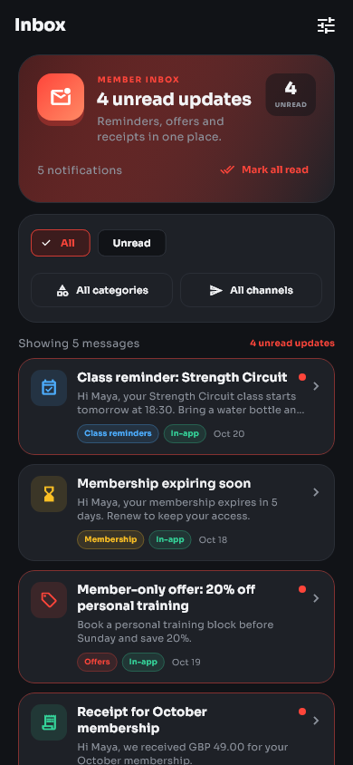
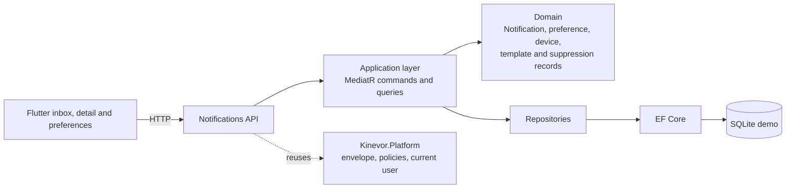
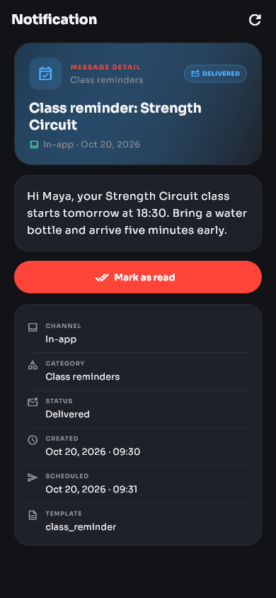
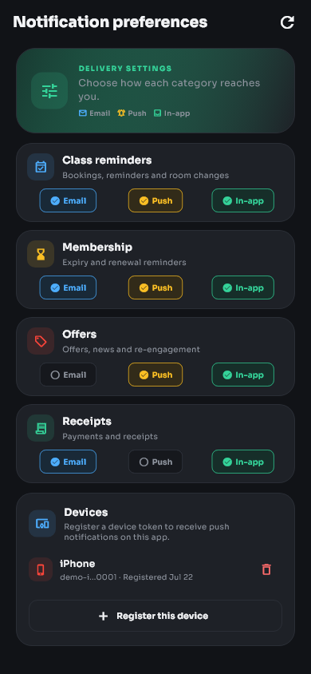
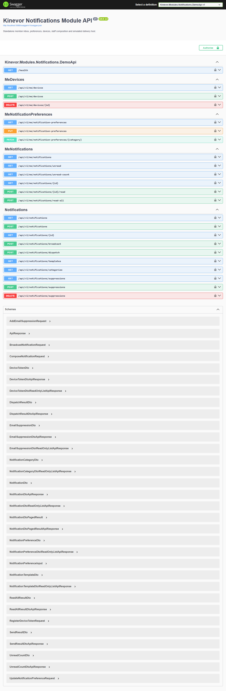

# Kinevor Notifications

Notification vertical slice for the Kinevor gym platform: a .NET 9 API and a
standalone Flutter package with a runnable example. The module owns member
inboxes, delivery records, preferences, device tokens, templates and e-mail
suppressions. It can be consumed independently, and the demo runs locally
from this monorepo.

[](https://github.com/SoftwareDeveloper98/kinevor/actions/workflows/ci.yml)
[](https://flutter.dev)
[](LICENSE)



## Why this module

Notifications is the member-facing record of what the gym told someone and how
it reached them. This module packages that slice for member applications and
staff tools without depending on an external e-mail or push provider.

- Members filter their inbox by category and channel, or show unread messages
  only.
- A detail view exposes the message, delivery status, template and timestamps,
  with an explicit mark-read action.
- Members choose Email, Push and In-app delivery for every category and manage
  their push devices.
- Staff inspect the notification ledger, compose from templates, broadcast,
  dispatch scheduled work and manage e-mail suppressions.
- Delivery is simulated deterministically, including scheduled sends and
  suppressed-address failures, so local demos and tests need no credentials.
- The Flutter package and API share one contract; the package injects a
  repository so hosts can replace the HTTP implementation.

## Architecture



The backend puts domain, application and API folders in one project and keeps
EF Core persistence separate. It depends on the published `Kinevor.Platform.*`
packages for the response envelope, authorization policies and current-user
abstractions. The Flutter package is a thin presentation layer over a typed
client and repository.

## Features

- Paged member inbox with category, channel and unread filters.
- Unread count, single mark-read and mark-all-read.
- Detail projection with message body, status, recipient, template, creation,
  sent, scheduled and failure metadata.
- Preferences for `class_reminders`, `membership_expiry`, `offers` and
  `receipts`, each with Email, Push and In-app flags. Missing categories default
  to enabled.
- Push-device registration, re-assignment and removal with masked token previews.
- Staff ledger filters, single compose, broadcast, scheduled dispatch, template
  catalogue and category catalogue.
- E-mail suppressions block delivery and record the failure reason.
- Notification delivery simulator for Email, Push and In-app channels; no
  provider SDKs or secrets are required.
- Flutter: injectable client/repository, inbox, detail and preferences screens,
  devices, dark theme, Sora typography, widget tests, golden tests and an example.
- SQLite demo with Maya Thompson's five-notification inbox, two other members,
  five templates, devices, suppressions and Swagger.

## Endpoints

| Method | Route | Policy | Used by |
| --- | --- | --- | --- |
| `GET` | `/api/v1/me/notifications?category=&channel=&unreadOnly=&page=&pageSize=` | `MemberOrAbove` | Member inbox |
| `GET` | `/api/v1/me/notifications/unread` | `MemberOrAbove` | Unread list |
| `GET` | `/api/v1/me/notifications/unread-count` | `MemberOrAbove` | Unread badge |
| `GET` | `/api/v1/me/notifications/{id}` | `MemberOrAbove` | Notification detail |
| `POST` | `/api/v1/me/notifications/{id}/read` | `MemberOrAbove` | Mark one read |
| `POST` | `/api/v1/me/notifications/read-all` | `MemberOrAbove` | Mark all read |
| `GET` | `/api/v1/me/notification-preferences` | `MemberOrAbove` | Preferences |
| `PUT` | `/api/v1/me/notification-preferences` | `MemberOrAbove` | Update several preferences |
| `PATCH` | `/api/v1/me/notification-preferences/{category}` | `MemberOrAbove` | Update one category |
| `GET` | `/api/v1/me/devices` | `MemberOrAbove` | Device list |
| `POST` | `/api/v1/me/devices` | `MemberOrAbove` | Register device |
| `DELETE` | `/api/v1/me/devices/{id}` | `MemberOrAbove` | Remove device |
| `GET` | `/api/v1/notifications?memberId=&category=&channel=&status=&unreadOnly=&page=&pageSize=` | `StaffOrAdmin` | Staff ledger |
| `GET` | `/api/v1/notifications/{id}` | `StaffOrAdmin` | Staff detail |
| `POST` | `/api/v1/notifications` | `StaffOrAdmin` | Compose one notification |
| `POST` | `/api/v1/notifications/broadcast` | `StaffOrAdmin` | Compose for several members |
| `POST` | `/api/v1/notifications/dispatch` | `StaffOrAdmin` | Deliver due notifications |
| `GET` | `/api/v1/notifications/templates` | `StaffOrAdmin` | Template catalogue |
| `GET` | `/api/v1/notifications/categories` | `StaffOrAdmin` | Category catalogue |
| `GET` | `/api/v1/notifications/suppressions?search=` | `StaffOrAdmin` | Suppression list |
| `POST` | `/api/v1/notifications/suppressions` | `StaffOrAdmin` | Add suppression |
| `DELETE` | `/api/v1/notifications/suppressions?email=` | `StaffOrAdmin` | Remove suppression |
| `GET` | `/health` | anonymous | Demo health check |
| `GET` | `/swagger` | demo only | API explorer |

All responses use the platform `ApiResponse<T>` envelope. Notification recipient
e-mails and device tokens are masked in projections. Member routes are scoped to
the authenticated member; requesting another member's notification returns
`404`.

## Screenshots

### Flutter

| Inbox | Notification detail |
| --- | --- |
|  |  |

| Preferences and devices |
| --- |
|  |

### API



## Quick start

The commands below use PowerShell; on macOS or Linux use forward slashes.

### Prerequisites

- .NET SDK 10 (the solution uses `.slnx`) and the ASP.NET Core 9 runtime.
- Flutter 3.35+ (the repository is verified with Flutter 3.47.8).
- Node.js is not required to build or test the repository.

### 1. Build the platform packages

The backend restores `Kinevor.Platform.*` from the sibling platform folder's
local package feed. Pack it once:

```powershell
dotnet pack ..\kinevor-platform\backend\Kinevor.Platform.slnx -c Release `
  -o ..\kinevor-platform\backend\artifacts\packages
```

If the platform packages are published to a registry, configure that source
instead and skip the local pack step.

### 2. Run the API

```powershell
dotnet restore backend\Kinevor.Modules.Notifications.slnx
dotnet run --project backend\samples\Kinevor.Modules.Notifications.DemoApi
```

The API listens on `http://localhost:5088`. Open
`http://localhost:5088/swagger` for the explorer. The demo creates a SQLite
database and seeds templates, notifications, preferences, devices and
suppressions on first run:

| Member | Id | Seeded inbox |
| --- | --- | --- |
| Maya Thompson | `11111111-1111-1111-1111-111111111111` | 5 notifications, 4 unread, 1 iOS device |
| Daniel Okafor | `22222222-2222-2222-2222-222222222222` | 1 notification, 1 Android device |
| Sofia Rossi | `33333333-3333-3333-3333-333333333333` | 1 failed e-mail notification |

The demo trusts development-only headers:

| Header | Purpose | Example |
| --- | --- | --- |
| `X-Demo-Role` | Selects the authenticated role | `Member`, `Staff`, `Admin`, `Trainer` |
| `X-Demo-User` | Sets the current user subject | `demo-member` |
| `X-Demo-Email` | Sets the current user e-mail | `maya.thompson@kinevor.demo` |
| `X-Demo-Member` | Binds a member identity | `11111111-1111-1111-1111-111111111111` |
| `X-Demo-Branch` | Selects the branch context | branch GUID |

These headers are a demo adapter only. Never enable them in production.

### 3. Run the Flutter example

```powershell
cd mobile\packages\kinevor_notifications
flutter pub get
cd example
flutter run -d chrome
```

The example targets `http://localhost:5088/api/v1` by default. Override it for an
emulator or remote host:

```powershell
flutter run -d chrome --web-port=4203 `
  --dart-define=KINEVOR_API_BASE_URL=http://localhost:5088/api/v1
```

On an Android emulator use `http://10.0.2.2:5088/api/v1`. The demo API allows the
local web origins `http://localhost:4200` through `http://localhost:4203`; use
one of those ports for a Flutter web run.

### 4. Refresh screenshots

Regenerate the Flutter goldens and copy them into the repository:

```powershell
cd mobile\packages\kinevor_notifications
flutter test --update-goldens test\notifications_golden_test.dart
Copy-Item test\goldens\notification_inbox.png ..\..\..\docs\screenshots\mobile-inbox.png
Copy-Item test\goldens\notification_detail.png ..\..\..\docs\screenshots\mobile-notification-detail.png
Copy-Item test\goldens\notification_preferences.png ..\..\..\docs\screenshots\mobile-preferences.png
```

With the API running, capture `http://localhost:5088/swagger/index.html` at
1440x1000 and save it as `docs/screenshots/api-swagger.png`.

## Testing

| Area | Command |
| --- | --- |
| Backend | `dotnet test backend\Kinevor.Modules.Notifications.slnx -c Release` |
| Flutter analysis | `cd mobile\packages\kinevor_notifications; flutter analyze` |
| Flutter tests | `cd mobile\packages\kinevor_notifications; flutter test` |
| Flutter format | `cd mobile\packages\kinevor_notifications; dart format --output=none --set-exit-if-changed lib test example/lib` |

The backend suite contains 24 domain and API tests covering lifecycle rules,
member isolation, preferences, devices, templates, compose, broadcast,
suppression failures, scheduled dispatch and role policies. The Flutter suite
covers the HTTP client, all three screens and golden images.

## Packages

| Ecosystem | Package | Contents |
| --- | --- | --- |
| NuGet | `Kinevor.Modules.Notifications` | Domain, application, API controllers and module registration |
| NuGet | `Kinevor.Modules.Notifications.EntityFrameworkCore` | `NotificationsDbContext`, mapping and repositories |
| Flutter | `kinevor_notifications` | API client, repository, inbox/detail/preferences screens, theme and strings |

Consume the Flutter package from the monorepo by path or git:

```yaml
dependencies:
  kinevor_notifications:
    git:
      url: https://github.com/SoftwareDeveloper98/kinevor.git
      path: mobile/packages/kinevor_notifications
      ref: main
```

The monorepo CI packs the platform once and feeds the artifacts to each module
job. Modules do not need a published registry to build.

## Design decisions

- **External member identity.** Notifications stores member ids but does not own
  profiles; member routes resolve identity from the host's `ICurrentUser`.
- **Deterministic delivery.** A simulator records sent or failed states instead
  of calling e-mail or push providers. Production hosts can replace
  `INotificationDeliverySimulator`.
- **Defaults are enabled.** A missing preference row means Email, Push and
  In-app are all on, so new categories work without a migration.
- **Read only after delivery.** Only delivered notifications can transition to
  read, and read operations are scoped to the owning member.
- **Masked projections.** Recipient e-mails and device tokens are partially
  masked in API responses; suppression management remains staff-only.
- **Thin Flutter client.** Screens depend on `NotificationsRepository`, so hosts
  can inject authentication, caching or offline behavior.
- **Demo auth is explicit.** Trust headers exist only in the demo host and are
  sent by the example client. Never enable them in production.
- **Visual contract in tests.** Flutter goldens make layout, typography and icon
  regressions visible.

## Repository layout

```text
kinevor-notifications/
  backend/
    src/Kinevor.Modules.Notifications/     domain, application, API
    src/Kinevor.Modules.Notifications.EntityFrameworkCore/
    samples/Kinevor.Modules.Notifications.DemoApi/
    tests/Kinevor.Modules.Notifications.Tests/
  mobile/
    packages/kinevor_notifications/        Flutter package
    packages/kinevor_notifications/example/ runnable demo
  docs/
    screenshots/
```

## Related modules

- [Kinevor Platform](../kinevor-platform) -
  shared API, auth, i18n, notices and Angular primitives.
- [Kinevor Identity & Access](../kinevor-identity-access)
- [Kinevor Trainers](../kinevor-trainers)
- [Kinevor Members](../kinevor-members)
- [Kinevor Memberships](../kinevor-memberships)
- [Kinevor Classes & Bookings](../kinevor-classes-bookings)
- [Kinevor Check-ins & Access](../kinevor-checkins-access)
- [Kinevor Payments & Billing](../kinevor-payments-billing)
- [Kinevor Public Site](../kinevor-public-site)
- [Kinevor Staff Dashboard](../kinevor-staff-dashboard)

## Verification

- Run this module's backend and mobile suites (commands above).
- The root CI runs the module in its backend, web and/or mobile matrix.
- See [PUBLISHING.md](PUBLISHING.md) only if you intend to distribute packages.

## Security

The demo role headers are intentionally insecure and exist only for local
screenshots and tests. Production hosts must use the platform authentication
stack, enforce the published policies, and keep the demo adapter disabled.
Notification bodies may contain member data; protect them with transport
encryption, least-privilege access and audit logging. Do not commit connection
strings, provider credentials, PATs or `.env` files.

## License

MIT. See [LICENSE](LICENSE).
