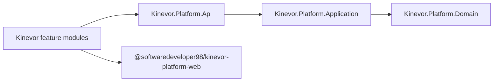

# Kinevor Platform

[](https://github.com/SoftwareDeveloper98/kinevor/actions/workflows/ci.yml)
[](LICENSE)

Shared .NET and Angular building blocks for the Kinevor gym platform. The
platform folder has no product UI of its own; it supplies the contracts and services
that every feature module consumes.

## Packages

| Ecosystem | Package | Contents |
| --- | --- | --- |
| NuGet | `Kinevor.Platform.Domain` | Entities, aggregates, results, value objects, enums and specifications |
| NuGet | `Kinevor.Platform.Application` | Repository and unit-of-work contracts, current user, branch context, paging and exceptions |
| NuGet | `Kinevor.Platform.Api` | `ApiResponse<T>`, role constants and authorization policy extensions |
| npm | `@softwaredeveloper98/kinevor-platform-web` | API envelopes, auth gateway/interceptor/guard, i18n, notices and theme services |

## Architecture



Backend projects target `net9.0`; the Angular library targets Angular 21.

## Requirements

- .NET SDK 9.0 or 10.0.
- Node.js 22.12+ or 24+ and npm 11 or later.
- No registry credentials are needed inside the monorepo; modules consume the
  local platform build.

## Build And Test

```powershell
dotnet test backend\Kinevor.Platform.slnx -c Release
dotnet pack backend\Kinevor.Platform.slnx -c Release -o backend\artifacts\packages

cd web
npm ci
npm run build
```

## Consume NuGet Packages (optional)

These steps apply only if you publish the platform packages to a registry.
Inside the monorepo, modules restore from the local package feed.

Configure the GitHub Packages source once:

```powershell
dotnet nuget add source https://nuget.pkg.github.com/SoftwareDeveloper98/index.json `
  --name github-kinevor `
  --username SoftwareDeveloper98 `
  --password $env:KINEVOR_PACKAGES_TOKEN `
  --store-password-in-clear-text
```

Then reference the packages:

```xml
<PackageReference Include="Kinevor.Platform.Domain" Version="0.1.0" />
<PackageReference Include="Kinevor.Platform.Application" Version="0.1.0" />
<PackageReference Include="Kinevor.Platform.Api" Version="0.1.0" />
```

## Consume The Angular Package (optional)

These steps apply only if you publish the package to a registry. Inside the
monorepo, modules bind to the sibling build with `npm run install:local`.

Create an `.npmrc` in the consuming workspace:

```ini
@softwaredeveloper98:registry=https://npm.pkg.github.com
//npm.pkg.github.com/:_authToken=${KINEVOR_PACKAGES_TOKEN}
```

Then install:

```powershell
npm install @softwaredeveloper98/kinevor-platform-web
```

Provide the shared services in the application bootstrap:

```ts
import {
  provideKinevorHttp,
  provideKinevorPlatform,
} from '@softwaredeveloper98/kinevor-platform-web';

export const appConfig = {
  providers: [
    provideKinevorHttp(),
    provideKinevorPlatform({ apiBaseUrl: '/api/v1' }),
  ],
};
```

## Local Development

Modules in this monorepo consume unpacked local artifacts instead of published
packages:

```powershell
dotnet pack backend\Kinevor.Platform.slnx -c Release -o backend\artifacts\packages
cd web
npm ci
npm run build
```

Each sibling module exposes `npm run install:local` for the Angular package.

## CI And Release

The root `.github/workflows/ci.yml` builds, tests and packs this platform first,
then injects the NuGet and Angular artifacts into the module matrices. No
registry publication is required for the monorepo build.

If you choose to distribute the packages:

1. Update `Directory.Build.props`, both `package.json` files and this changelog.
2. Run the platform tests and build from a clean checkout.
3. Create and push a tag.
4. Publish the three NuGet packages and the Angular package to your registry.

See [PUBLISHING.md](PUBLISHING.md) for the optional release checklist. A
`KINEVOR_PACKAGES_TOKEN` repository secret is only needed by consumers that
restore private packages from another repository.

## Security

Demo modules are responsible for their own authentication adapters. Never commit
`.env` files, PATs or signing keys. Report security issues privately to the
repository owner.

## License

MIT. See [LICENSE](LICENSE).
