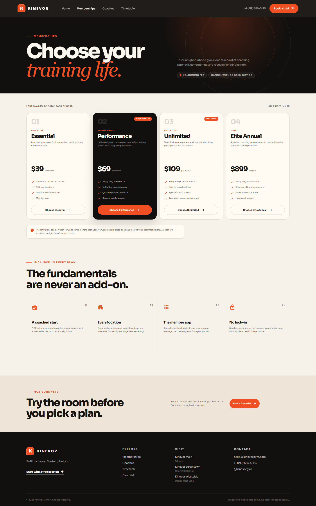
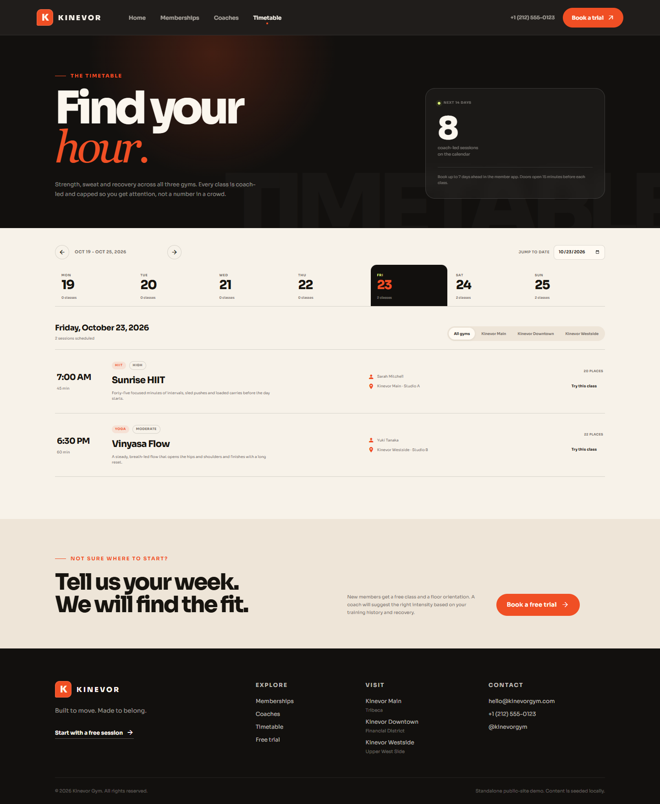
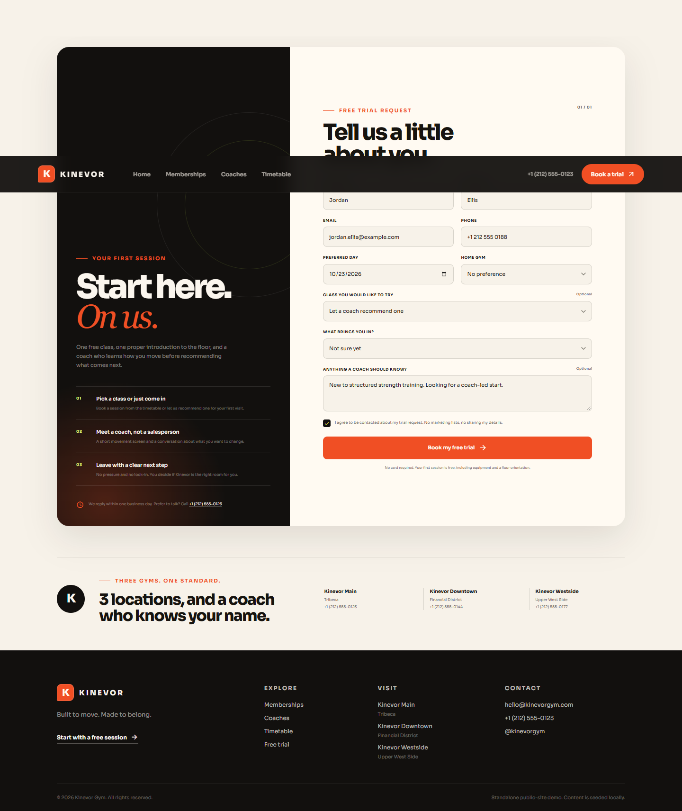
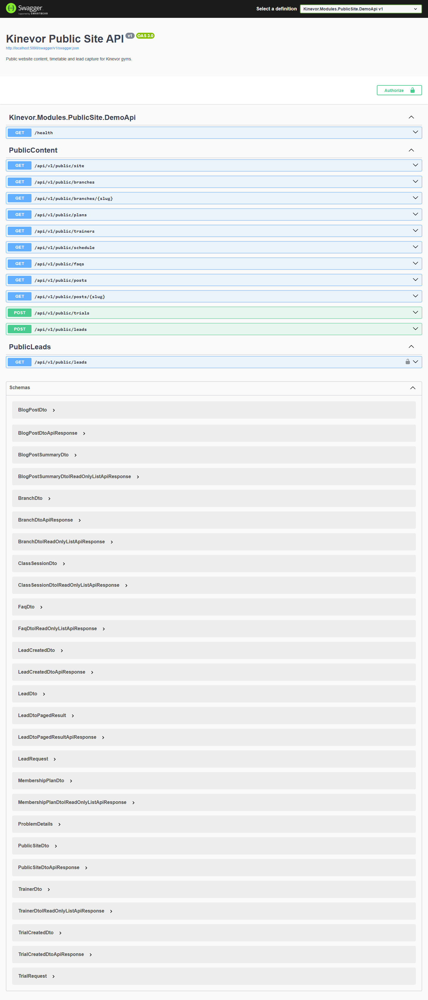

# Kinevor Public Site

A complete public website for Kinevor: a coach-led strength and movement gym
with three New York locations. This module contains a tested .NET module and
demo API for public content and lead capture, plus an Angular 21 component
library and reference website.

The experience is editorial rather than templated: local typography, warm paper
surfaces, a dark gym-floor palette, coach-led class discovery and a free-trial
request that feels like the start of a relationship instead of a checkout. All
gym locations, plans, coaches and editorial content are fictional demo data.

## Screenshots

| Landing | Memberships |
| --- | --- |
|  |  |

| Timetable | Free trial |
| --- | --- |
|  |  |



## What It Includes

- A public site profile with three branches, opening hours, facilities,
  contact details and gym statistics.
- Membership plans with monthly and annual billing, features, badges and a
  featured tier.
- A coach directory with specialities, certifications and experience.
- A rolling class timetable with branch filters, day navigation and direct
  trial booking.
- FAQs and published articles.
- Free-trial requests with class, branch, preferred date, goal and notes.
- Website enquiries with consent capture.
- A staff/admin lead inbox combining trials and enquiries with status, search
  and pagination.
- A responsive five-screen Angular site with local fonts, no remote images and
  reduced-motion support.
- xUnit API and domain tests, Vitest gateway and facade tests, CI and release
  workflows, and real Playwright screenshots.

## Project Layout

```text
backend/
  src/
    Kinevor.Modules.PublicSite/                 Domain, application, API and DI
    Kinevor.Modules.PublicSite.EntityFrameworkCore/  Persistence and repository
  samples/
    Kinevor.Modules.PublicSite.DemoApi/         Runnable SQLite-backed demo API
  tests/
    Kinevor.Modules.PublicSite.Tests/           Domain and HTTP contract tests
web/
  projects/
    public-site/                                Angular component library
    demo/                                       Reference website on port 4208
  scripts/                                      Local package install and capture
docs/screenshots/                               Captured product screenshots
```

The .NET projects target `net9.0`; `global.json` pins the .NET 10 SDK with
feature roll-forward. The Angular workspace uses Angular 21, standalone
components, signals and OnPush change detection.

## Quick Start

The commands below use PowerShell; on macOS or Linux use forward slashes.

### Prerequisites

- .NET SDK 10.0.100 or a compatible feature band.
- Node.js 22.12+ or 24+, with npm 11+.
- Google Chrome for screenshot capture.
- The `Kinevor.Platform.*` NuGet packages. This module's `backend/nuget.config`
  expects them under the sibling `kinevor-platform/backend/artifacts/packages`
  directory. A hosted feed can be used instead.
- The local `@softwaredeveloper98/kinevor-platform-web` package, or a registry
  that hosts it.

### 1. Run the demo API

From this module's folder:

```powershell
dotnet restore backend/Kinevor.Modules.PublicSite.slnx
dotnet run --project backend/samples/Kinevor.Modules.PublicSite.DemoApi
```

The API starts on `http://localhost:5090`. Swagger is available at
`http://localhost:5090/swagger/index.html` and the health check at
`http://localhost:5090/health`.

The demo creates `publicsite-demo.db` beside the project and seeds it on first
run. Delete `publicsite-demo.db`, `publicsite-demo.db-shm` and
`publicsite-demo.db-wal`, then restart the API to reset the content. Seed data
uses the current local date, so the timetable always has upcoming classes.

### 2. Run the website

In a second terminal:

```powershell
cd web
npm run install:local
npm start
```

Open `http://localhost:4208`. The demo is configured for the API at
`http://localhost:5090/api/v1` and CORS is restricted to the demo origin.

`install:local` temporarily points the workspace at the sibling
`kinevor-platform/web/dist/kinevor-platform-web` package and runs `npm install`.
Use `npm install` directly after authenticating to a registry if the platform
package is available from that feed.

### 3. Verify

```powershell
dotnet test backend/Kinevor.Modules.PublicSite.slnx -c Release
cd web
npm test
npm run build:all
npx ng build demo --configuration production
```

To refresh the screenshots, start both servers and run:

```powershell
cd web
npm run capture:screenshots
```

The script opens Google Chrome at `1440x1040`, waits for fonts and content,
checks each page for horizontal overflow, fills the trial form and writes the
five images under `docs/screenshots`.

## API

All public JSON responses use the platform `ApiResponse<T>` envelope with
`success`, `data`, `message` and `errors` fields. The lead inbox returns a
`PagedResult<LeadDto>` inside the same envelope.

| Method | Route | Purpose |
| --- | --- | --- |
| `GET` | `/api/v1/public/site` | Site profile, statistics and branches |
| `GET` | `/api/v1/public/branches` | All locations |
| `GET` | `/api/v1/public/branches/{slug}` | One location |
| `GET` | `/api/v1/public/plans` | Published membership plans |
| `GET` | `/api/v1/public/trainers` | Published coaches |
| `GET` | `/api/v1/public/schedule` | Upcoming published classes |
| `GET` | `/api/v1/public/faqs` | Published FAQs |
| `GET` | `/api/v1/public/posts` | Published article summaries |
| `GET` | `/api/v1/public/posts/{slug}` | One published article |
| `POST` | `/api/v1/public/trials` | Request a free trial |
| `POST` | `/api/v1/public/leads` | Send a website enquiry |
| `GET` | `/api/v1/public/leads` | Staff/admin trial and enquiry inbox |

The schedule accepts optional `from`, `to` and `branchId` query parameters. The
lead inbox accepts `kind`, `status`, `search`, `page` and `pageSize`, and requires
the `StaffOrAdmin` policy. The demo API simulates that policy with the
`X-Demo-Role: Admin` or `X-Demo-Role: Staff` header.

Example trial request:

```json
{
  "firstName": "Jordan",
  "lastName": "Ellis",
  "email": "jordan.ellis@example.com",
  "phone": "+1 212 555 0188",
  "preferredDate": "2026-10-23T12:00:00Z",
  "classSessionId": null,
  "branchId": null,
  "goal": "Build strength",
  "notes": "New to structured strength training.",
  "consentToContact": true
}
```

Requests without consent are rejected. Duplicate open trials for the same email
and preferred session return a conflict. A selected class takes precedence over
a preferred date.

## Web Library

The package is `@softwaredeveloper98/kinevor-public-site-web` and ships the
gateway, facade, provider, routes and standalone screens:

- `/` landing page
- `/plans`
- `/trainers`
- `/schedule`
- `/trial`

```ts
import { provideHttpClient } from '@angular/common/http';
import { provideRouter } from '@angular/router';
import {
  PUBLIC_SITE_ROUTES,
  providePublicSite,
} from '@softwaredeveloper98/kinevor-public-site-web';

export const appConfig = {
  providers: [
    provideHttpClient(),
    provideRouter(PUBLIC_SITE_ROUTES),
    providePublicSite({ apiBaseUrl: 'https://api.example.com/api/v1' }),
  ],
};
```

`HttpPublicSiteGateway` implements the typed `PublicSiteGateway` contract and
unwraps the API envelope. Supply an alternative gateway under
`PUBLIC_SITE_GATEWAY` for a different backend. `PublicSiteFacade` loads the six
content collections together, exposes signals and shares an in-flight request.

The library needs `@angular/common`, `@angular/core`, `@angular/forms`,
`@angular/router` and `rxjs` as peers. The demo application adds the Sora
typeface and global CSS custom properties.

## Design And Content

- Palette: charcoal `#12100e`, warm paper `#f7f2e9`, ember `#f04f24` and a
  restrained acid accent for the timetable.
- Type: local Sora variable font with a serif italic display counterpoint.
- No external image service is required. Hero visuals, portraits, rings and
  texture are composed from CSS, grids, gradients and typographic monograms.
- The seeded story is complete and coherent: three gyms, four coaches, four
  published plans, upcoming classes, FAQs and articles.
- Screens are responsive, keyboard reachable, use semantic landmarks and respect
  `prefers-reduced-motion`.

## Persistence

`PublicSiteDbContext` maps the site profile, branches, plans, trainers, classes,
FAQs, articles, trials and enquiries. JSON-backed string collections use EF Core
value converters with explicit comparers. The context stamps `CreatedAt` and
`UpdatedAt` using the registered `TimeProvider`.

The demo uses SQLite and `EnsureCreatedAsync` so it has no migration step.
Production hosts should provide migrations, configure the database explicitly
and apply their own authentication and authorization.

## CI And Release

The root `.github/workflows/ci.yml` runs this module in the backend and web
matrices: it restores the platform artifacts, builds and tests the API, then
installs, tests and builds the Angular library and demo. No registry
publication is required for the monorepo build.

Optional package distribution is documented in [PUBLISHING.md](PUBLISHING.md).

## Verification

- Run this module's backend and web suites (commands above).
- The root CI runs the module in its backend, web and/or mobile matrix.
- See [PUBLISHING.md](PUBLISHING.md) only if you intend to distribute packages.

## License

MIT. See [LICENSE](LICENSE).
